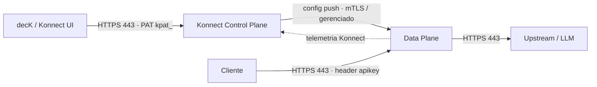
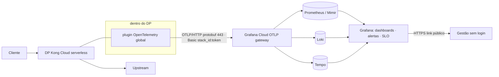
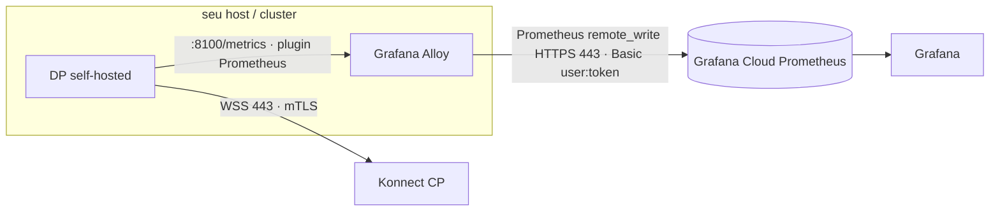
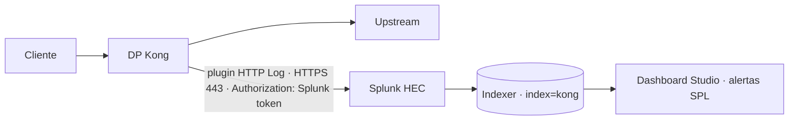
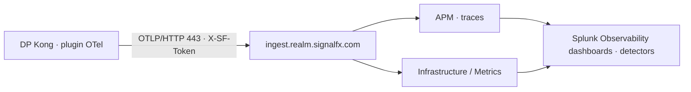
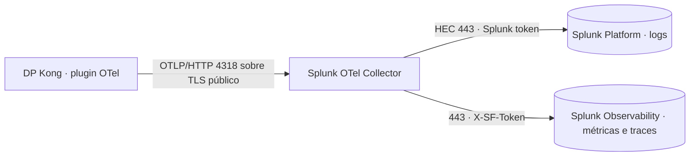
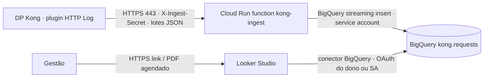
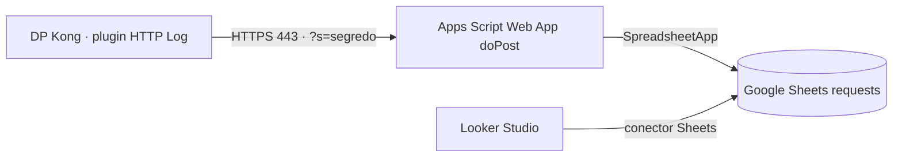
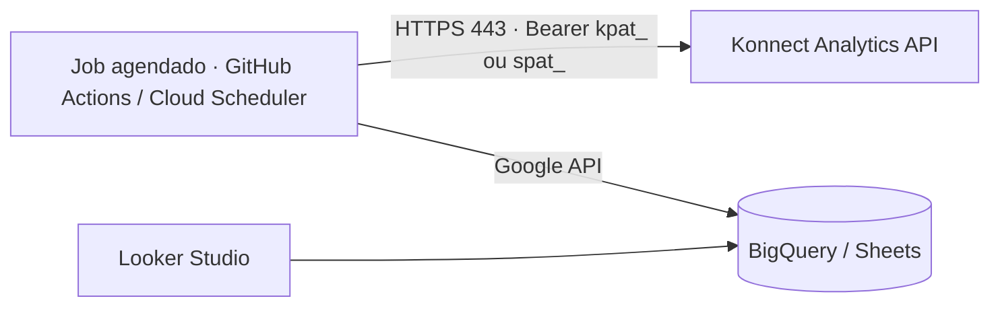

# Arquitetura: quem fala com quem, em cada caso

Para cada destino: os componentes, o diagrama e **todas as conexões** (origem → destino, protocolo, quem inicia, autenticação e o que trafega). A configuração está nos guias de cada destino ([Grafana](GRAFANA-CLOUD.md), [Splunk](SPLUNK.md), [Looker Studio](LOOKER-STUDIO.md)).

## Componentes comuns

| Componente | O que é | Onde roda |
|---|---|---|
| **Cliente** | app, `curl` ou o gerador `kong-traffic` | qualquer lugar |
| **Konnect Control Plane (CP)** | guarda a configuração (rotas, plugins, consumers) e a distribui | Kong Cloud (SaaS) |
| **Data Plane (DP)** | o gateway que recebe o tráfego e executa os plugins | Kong Cloud *serverless* (gerenciado) ou self-hosted (Docker/K8s) |
| **Upstream** | a API de verdade (aqui, `httpbin.org`; em produção, os serviços e os LLMs) | qualquer lugar |
| **decK / Konnect UI** | aplica a configuração no CP | sua máquina ou CI |
| **Plugin de observabilidade** | roda **dentro do DP** e emite os dados (OpenTelemetry, HTTP Log, Prometheus) | dentro do DP |

Base, comum a todos os casos:

| # | De → Para | Protocolo | Quem inicia | Auth | Trafega |
|---|---|---|---|---|---|
| 1 | decK/UI → CP | HTTPS 443 (Konnect API) | decK | Personal/System Access Token | configuração declarativa |
| 2 | CP → DP | WSS/HTTPS 443 | **DP** (abre a conexão com o CP) | mTLS (cert do cluster) ou gerenciado (serverless) | configuração |
| 3 | Cliente → DP | HTTPS 443 (proxy 8000/8443 se self-hosted) | cliente | Key Auth (`apikey`), OIDC etc. | requisição |
| 4 | DP → Upstream | HTTPS 443 | DP | a do upstream (ex.: API key do LLM, injetada pelo AI Proxy) | requisição e resposta |
| 5 | DP → CP (telemetria) | HTTPS 443 (`*.tp.konghq.com`) | DP | mTLS | analytics do Konnect |

---

## 1. Grafana Cloud: push via OpenTelemetry (o que está no ar)

| # | De → Para | Protocolo / porta | Inicia | Auth | Trafega |
|---|---|---|---|---|---|
| G1 | plugin OTel → OTLP gateway `/otlp/v1/traces` | OTLP/HTTP protobuf, 443 | DP (push) | `Authorization: Basic base64(stack_id:glc_token)` | spans por requisição |
| G2 | plugin OTel → `/otlp/v1/logs` | OTLP/HTTP, 443 | DP | idem | logs de acesso (e prompts, se `log_payloads`) |
| G3 | plugin OTel → `/otlp/v1/metrics` | OTLP/HTTP, 443, a cada 15 s | DP | idem | `http.server.request.count`, `kong.latency.*`, `gen_ai.*` |
| G4 | OTLP gateway → Mimir / Loki / Tempo | interno do Grafana Cloud | Grafana | — | converte para Prometheus (`job="kong"`), Loki e Tempo |
| G5 | Grafana → Mimir / Loki / Tempo | interno | Grafana | — | consultas dos painéis |
| G6 | Navegador → Grafana | HTTPS 443 | usuário | login, ou **link público** (sem login) | dashboard |

**Quem fala com quem:** o DP **empurra** para o Grafana. O Grafana nunca chama o Kong. Sem agente e sem porta aberta.

## 1b. Grafana Cloud: pull via Prometheus + Alloy (DP self-hosted)

| # | De → Para | Protocolo / porta | Inicia | Auth | Trafega |
|---|---|---|---|---|---|
| P1 | Alloy → DP `:8100/metrics` | HTTP, **local** (127.0.0.1 ou rede interna) | **Alloy** (scrape a cada 15 s) | nenhuma; a porta **não** pode ser pública | `kong_http_requests_total`, `kong_request_latency_ms`, `kong_ai_llm_*` |
| P2 | Alloy → Prometheus remote_write `/api/prom/push` | HTTPS 443 | Alloy | `basic_auth` instance_id + token `glc_` | séries |
| P3 | DP → CP | WSS 443 | DP | mTLS (cluster cert/key) | configuração e telemetria |

Funciona só com DP self-hosted. No serverless não existe acesso à porta 8100.

---

## 2. Splunk

### 2A. HTTP Log → HEC (logs, prompts e tudo via SPL)

| # | De → Para | Protocolo / porta | Inicia | Auth | Trafega |
|---|---|---|---|---|---|
| S1 | plugin HTTP Log → HEC `/services/collector/raw` | HTTPS 443 (Cloud) ou 8088 (Enterprise) | DP (push, em lotes pela `queue`) | `Authorization: Splunk <HEC token>` | 1 JSON por requisição: status, latências, consumer, rota, IA, payload |
| S2 | HEC → Indexer | interno do Splunk | Splunk | — | eventos `sourcetype=kong:access` |
| S3 | Search Head → Indexer | interno | Splunk | — | buscas SPL dos painéis e alertas |

### 2B. OpenTelemetry → Splunk Observability Cloud (métricas e traces)

| # | De → Para | Protocolo | Inicia | Auth | Trafega |
|---|---|---|---|---|---|
| S4 | plugin OTel → `/v2/trace/otlp` | OTLP/HTTP 443 | DP | `X-SF-Token` (ingest) | spans |
| S5 | plugin OTel → `/v2/datapoint/otlp` | OTLP/HTTP 443 | DP | `X-SF-Token` | métricas |
| — | logs | ❌ não suportado por esse caminho | — | — | use o 2A junto |

### 2C. OpenTelemetry → Splunk OTel Collector → Platform + Observability

| # | De → Para | Protocolo | Inicia | Auth | Trafega |
|---|---|---|---|---|---|
| S6 | plugin OTel → Collector `:4318/v1/*` | OTLP/HTTP, **precisa de URL pública com TLS** se o DP for serverless | DP | header que você definir (ex.: bearer) e validar no collector | traces, logs e métricas |
| S7 | Collector → HEC | HTTPS 443 | Collector | HEC token | logs |
| S8 | Collector → Observability ingest | HTTPS 443 | Collector | `X-SF-Token` | métricas e traces |

---

## 3. Looker Studio

O Looker Studio **só lê de armazenamento**. Sempre existe uma peça no meio.

### 3A. HTTP Log → Cloud Run → BigQuery (produção)

| # | De → Para | Protocolo | Inicia | Auth | Trafega |
|---|---|---|---|---|---|
| L1 | plugin HTTP Log → Cloud Run | HTTPS 443 | DP (push em lotes) | header secreto `X-Ingest-Secret` (ou IAM com ID token, mais seguro) | array JSON de eventos |
| L2 | Cloud Run → BigQuery | Google API (gRPC/HTTPS) | function | service account da function (`roles/bigquery.dataEditor`) | linhas |
| L3 | Looker Studio → BigQuery | Google API | Looker (cada abertura ou refresh do cache) | credenciais do dono da fonte (ou service account) | consultas SQL |
| L4 | Navegador → Looker Studio | HTTPS | usuário | conta Google ou link público | relatório |

### 3B. HTTP Log → Apps Script → Google Sheets (hack / demo)

| # | De → Para | Protocolo | Inicia | Auth | Trafega |
|---|---|---|---|---|---|
| L5 | plugin HTTP Log → `script.google.com/macros/s/…/exec` | HTTPS 443 (responde 302) | DP | segredo na query string | lotes JSON |
| L6 | Apps Script → Sheets | interno do Google | script (roda como o dono) | conta do dono | linhas |
| L7 | Looker Studio → Sheets | Google API | Looker | conta do dono | leitura |

### 3C. API do Konnect → job agendado → BigQuery/Sheets (agregados)

| # | De → Para | Protocolo | Inicia | Auth | Trafega |
|---|---|---|---|---|---|
| L8 | Job → Konnect Analytics API | HTTPS 443 | job (ex.: a cada 15 min) | System Access Token (`spat_`) | agregados (reqs, latência, status por rota) |
| L9 | Job → BigQuery/Sheets | Google API | job | service account | linhas agregadas |

Não toca no gateway: não precisa de plugin, e é o caminho com menos dado sensível.

---

## Comparativo rápido

| Caso | Peças além do Kong | Quem inicia a conexão | Dado por requisição | Prompts | Tempo real |
|---|---|---|---|---|---|
| 1 Grafana OTel | nenhuma | DP → Grafana | ✅ | ✅ (Loki) | ✅ ~15 s |
| 1b Grafana Alloy | Alloy | Alloy → DP (scrape) e Alloy → Grafana | métricas agregadas | ❌ | ✅ ~15 s |
| 2A Splunk HEC | nenhuma | DP → Splunk | ✅ | ✅ | ✅ segundos |
| 2B Splunk O11y | nenhuma | DP → Splunk | métricas e traces | ❌ | ✅ |
| 2C Splunk Collector | Collector | DP → Collector → Splunk | ✅ | ✅ | ✅ |
| 3A Looker BigQuery | Cloud Run + BigQuery | DP → Cloud Run → BQ ← Looker | ✅ | ✅ (mascarado) | ~1 min (cache do Looker) |
| 3B Looker Sheets | Apps Script + Sheets | DP → Apps Script → Sheets ← Looker | ✅ (pouco volume) | ⚠️ não recomendado | minutos |
| 3C Looker agregados | job + BQ/Sheets | job → Konnect, job → BQ ← Looker | ❌ (agregado) | ❌ | 15 min+ |

### Regras de rede que valem para todos

- O **DP só faz conexões de saída** (443) para o CP, os upstreams e o destino de observabilidade. Nenhum destino precisa alcançar o DP, **exceto** o scrape do Alloy (1b), que deve ficar na rede interna.
- No DP **serverless**, todo destino tem que ser **público, com TLS e certificado válido** (o `ssl_verify` fica ligado).
- Segredos dos destinos (token OTLP, HEC, segredo de ingest) devem ficar num **Vault do Konnect** e ser referenciados como `{vault://…}` na configuração do plugin.
